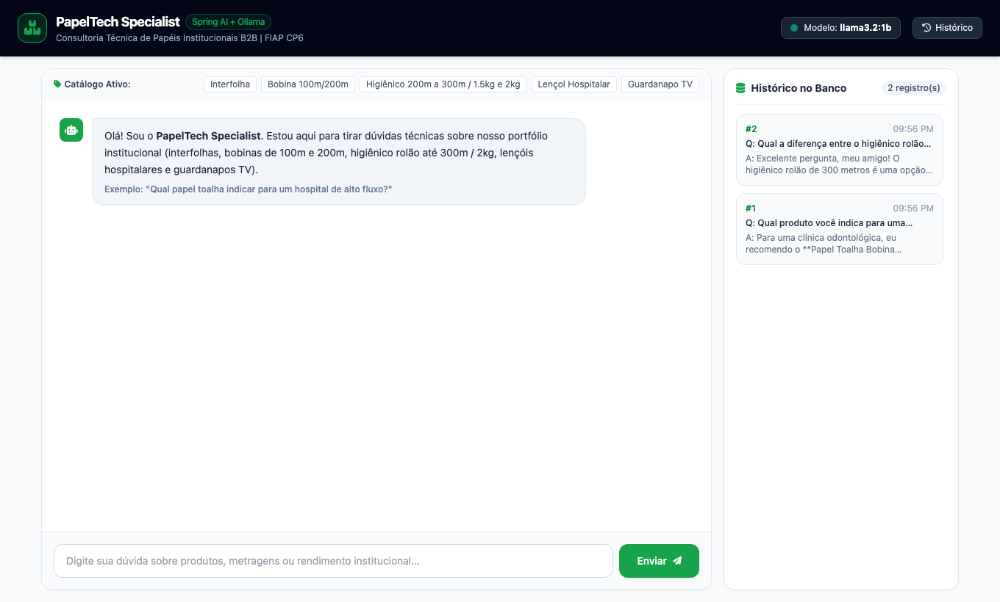
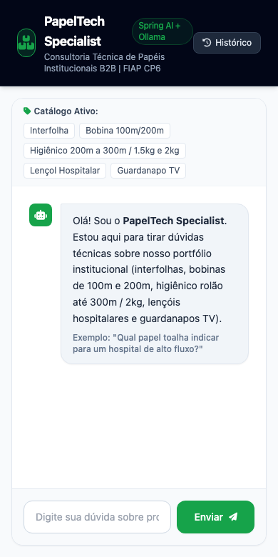
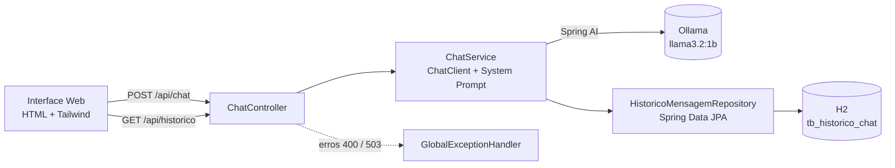

<h1 align="center">📄 PapelTech Specialist</h1>

<p align="center">
  Assistente de IA especialista em <b>papéis institucionais B2B</b>, com Spring Boot, Spring AI e Ollama local.<br/>
  <sub>FIAP · Checkpoint 6 · Arquiteturas Disruptivas: IoT, IoB e IA Generativa</sub>
</p>

<p align="center">
  
  
  
  
  
  
</p>

<p align="center">
  <a href="#-sobre-o-projeto">Sobre</a> •
  <a href="#-demonstração">Demonstração</a> •
  <a href="#-arquitetura">Arquitetura</a> •
  <a href="#-como-executar">Como executar</a> •
  <a href="#-api">API</a> •
  <a href="#-testes">Testes</a> •
  <a href="#-equipe">Equipe</a>
</p>

---

## 💡 Sobre o projeto

O **PapelTech Specialist** recebe perguntas em português, consulta um modelo de IA **executado localmente pelo Ollama** (sem chave de API e sem custo) e devolve respostas técnicas sobre o portfólio de papéis institucionais. Cada interação é registrada em banco de dados.

**Portfólio coberto pelo assistente**

| Produto | Detalhes |
| :-- | :-- |
| Papel toalha interfolha | Dispensers folha a folha |
| Papel toalha bobina institucional | 100 m e 200 m |
| Papel higiênico institucional (rolão) | 200 m, 250 m e 300 m · 1,5 kg e 2 kg |
| Lençol hospitalar | Macas em clínicas, consultórios e hospitais |
| Guardanapo TV | Dispensers de balcão |

Perguntas fora desse domínio são recusadas educadamente pelo *system prompt*.

## 🎬 Demonstração

📺 **Vídeo:** [assista no YouTube](https://youtu.be/dpKhW2Fp-BI)

<p align="center">
  
</p>

<p align="center">
  
</p>

## 🏛️ Arquitetura



```text
src/main/java/br/com/fiap/cp6
├── controller   # Endpoints REST
├── service      # ChatClient do Spring AI, prompt e persistência
├── repository   # Spring Data JPA
├── model        # Entidade HistoricoMensagem
├── dto          # ChatRequest e ChatResponse com Bean Validation
└── handler      # GlobalExceptionHandler
```

**Decisões**
- **Ollama local:** sem credenciais no repositório e sem dependência de cota ou rede.
- **H2 em memória:** o avaliador roda o projeto com um único comando. O script [`schema.sql`](src/main/resources/schema.sql) cobre PostgreSQL ou MySQL.
- **Temperatura 0.1:** respostas mais estáveis e técnicas em um modelo pequeno.
- **Filtro de saída:** remove "pedidos de desculpas" espúrios que o `llama3.2:1b` gera em perguntas comparativas.

## 🚀 Como executar

**Pré-requisitos:** Java 21 e [Ollama](https://ollama.com/download) instalado.

```bash
# 1. Baixar o modelo (uma vez)
ollama pull llama3.2:1b

# 2. Conferir o serviço
curl http://localhost:11434/api/tags

# 3. Subir a aplicação (Maven Wrapper incluso)
./mvnw spring-boot:run
```

Acesse **http://localhost:8080**. Se o modelo não for encontrado, confira se o nome em `application.properties` é idêntico ao de `ollama list`.

| Configuração | Propriedade |
| :-- | :-- |
| Provedor | `spring.ai.model.chat=ollama` |
| URL do Ollama | `spring.ai.ollama.base-url=http://localhost:11434` |
| Modelo | `spring.ai.ollama.chat.options.model=llama3.2:1b` |

**Banco H2:** console em http://localhost:8080/h2-console · JDBC `jdbc:h2:mem:papeisdb` · usuário `sa` · senha vazia.

## 🔌 API

### `POST /api/chat`

```json
{ "mensagem": "Qual produto você indica para uma clínica odontológica?" }
```

```json
{
  "id": 1,
  "resposta": "Para uma clínica odontológica, recomendo o lençol hospitalar...",
  "provedor": "ollama",
  "modelo": "llama3.2:1b",
  "dataHora": "2026-11-01T21:56:13.120"
}
```

| Status | Quando |
| :-- | :-- |
| `200` | Pergunta respondida e registrada |
| `400` | Mensagem vazia ou acima de 1000 caracteres |
| `503` | Ollama indisponível |

Exemplo de `400`:

```json
{
  "status": 400,
  "mensagem": "Erro de validação nos campos informados.",
  "erros": { "mensagem": "A mensagem não pode estar vazia." }
}
```

### `GET /api/historico`

Lista todas as interações, da mais recente para a mais antiga, com `id`, `pergunta`, `resposta`, `provedor`, `modelo` e `dataHora`.

A coleção do Postman está em [`CP6_Postman_Collection.json`](CP6_Postman_Collection.json) com 5 cenários: consulta válida, comparativo de produtos, mensagem vazia, pergunta fora do domínio e histórico.

## 🧪 Testes

```bash
./mvnw test
```

Os testes usam `MockMvc` com o serviço simulado, então não dependem de rede, créditos ou do Ollama. Cobrem: pergunta válida (200), mensagem vazia (400) e consulta ao histórico (200).

## 👥 Equipe

<table align="center">
  <tr>
    <td align="center">
      <a href="https://github.com/Gabriel-Maciel06">
        <br/>
        <b>Gabriel Maciel Alves de Oliveira</b>
      </a><br/>
      <sub>RM 562795 · Turma 2TDSR</sub><br/>
      <sub>IDE: IntelliJ IDEA</sub>
    </td>
  </tr>
</table>

## ⚠️ Limitações

- O `llama3.2:1b` é um modelo pequeno: pode errar detalhes técnicos de produto. O `llama3.2:3b` dá respostas melhores, bastando trocar o nome do modelo em `application.properties`.
- O histórico em H2 é perdido ao reiniciar a aplicação.
- Não há memória de conversa: cada pergunta é independente.
